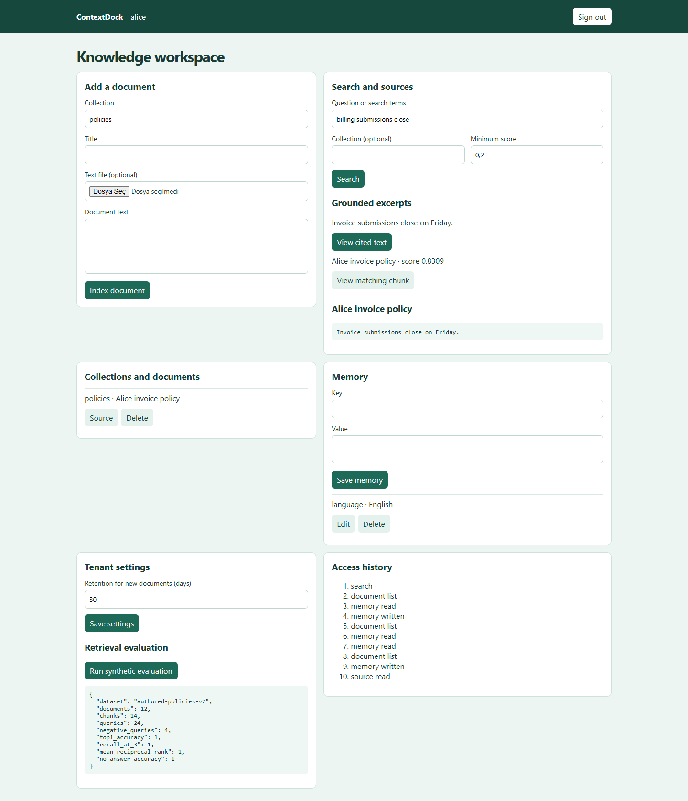

# ContextDock

ContextDock indexes text documents inside tenant-owned collections. Search retrieves similar chunks and returns exact excerpts with document IDs and character offsets. A separate memory store supports private key/value records with version-checked updates and deletion.



## Run locally

Use Python 3.12 and a SQLite build that can load extensions. The pinned `sqlite-vec` package supplies the vector extension.

```sh
python -m venv .venv
.venv/bin/python -m pip install -r requirements-dev.txt
DEMO_MODE=true .venv/bin/python -m uvicorn contextdock.app:from_env --factory --host 127.0.0.1
```

On PowerShell, use `.venv/Scripts/python.exe` and set `$env:DEMO_MODE = 'true'` before starting Uvicorn. Open [http://127.0.0.1:8000](http://127.0.0.1:8000) and connect as **Demo Alice**. Add the following document in the `policies` collection.

```text
Invoice submissions close on Friday at 16:00. Late invoices move to the next cycle.
```

Search for `billing submissions close`, view the cited text, then sign out and repeat as **Demo Bob**. Bob starts with a separate collection and memory store. Sign back in as Alice and delete the source to remove its document and vector entries.

For Docker, build with `docker build -t contextdock .` and run with `docker run --rm -p 127.0.0.1:8000:8000 -e DEMO_MODE=true -v contextdock-data:/app/data contextdock`.

## Design

FastAPI resolves the tenant from a bearer token. SQLite stores source records, chunks, settings, memory and audit actions. The `vec0` index partitions embeddings by tenant and collection. A second tenant condition gates source metadata and content. Chunks retain character offsets and overlap boundaries. The ranker combines cosine similarity with normalized token overlap. The default offline encoder uses deterministic term hashing and a small synonym map. Default search returns extractive answers and makes no generative model calls. Uploaded text is passed to embedding and retrieval routines as data. Account connections clear prior tenant views and memory editing state.

Document deletion removes vectors, chunks and source content in one transaction. Expiration hides sources immediately and background cleanup prunes expired rows. Retention settings apply to future uploads. Key/value records use UUID versions to detect stale updates, including after a key is deleted and recreated. Audit events contain action names, timestamps and document IDs where relevant.

## Configuration

Disable demo mode and supply `TENANT_TOKENS_JSON` as a map from tenant slugs to distinct random bearer tokens of at least 32 characters. Set `DATABASE_PATH` to persistent storage. FastAPI's `/docs` lists the endpoints for documents, search, memory, audit and settings.

Set `EMBEDDING_PROVIDER=openai-compatible`, `EMBEDDING_ENDPOINT`, `EMBEDDING_MODEL` and `EMBEDDING_API_KEY` to use an authorized HTTPS embeddings API that supports 128 dimensions. The provider receives uploaded text and search queries. The database records the selected embedding configuration. Use distinct databases for distinct models and reindex when changing providers. Hosted embedding calls require separately authorized credentials and budget.

To enable generative RAG, separately set `ANSWER_PROVIDER=openai-compatible`, `ANSWER_MODEL`, `ANSWER_API_KEY` and optionally `ANSWER_ENDPOINT`. The configured HTTPS Chat Completions endpoint receives only the question and up to five excerpts retrieved for the authenticated tenant. It receives no other tenant's documents or memory records. With no retrieved evidence, no generation request is made. `ANSWER_PROVIDER=off` is the default.

Generated claims require exact quotations and supplied chunk IDs. The application validates quotations against the source, computes citation offsets itself, and rechecks source availability after the provider returns, including on provider failure. Unknown citations, mismatched quotations and documents deleted during generation are excluded. The UI labels generated answers separately from grounded excerpts. Provider errors fall back to extractive results with a stable error code; response content and credentials are not exposed. Requests have a ten-second total deadline and bounded structured output. Citation validation establishes source provenance, not semantic correctness of every generated claim; review the quoted evidence. Live paid generation has not been verified; its protocol and isolation boundaries use injected responses in tests.

## Verification

```sh
python -m pytest -q
python -m contextdock.evaluate
ruff check contextdock tests
python -m pip_audit
```

The evaluator uses 12 authored synthetic policy documents, including long documents split into 14 chunks, with 24 known-source queries and four unrelated negative queries. It reports document-level top-one accuracy, recall at three, mean reciprocal rank, no-answer accuracy and per-query source ranks against a temporary real SQLite vector index. This is a reproducible regression fixture, not a real-world retrieval benchmark. The API tests verify two-user isolation, citations, expiry, source/vector deletion, stale memory writes, remote embedding contracts and generated citation checks, including deletion during generation.

With a running local demo, `python tests/smoke_app.py --url http://127.0.0.1:8000` verifies actual vector search for Alice and Bob, private memory updates, cross-tenant source denial and deletion. CI repeats this flow in the built Docker image. The browser demonstration also checks tenant switching, cited text, memory correction, deletion, the evaluation panel and mobile layout.
